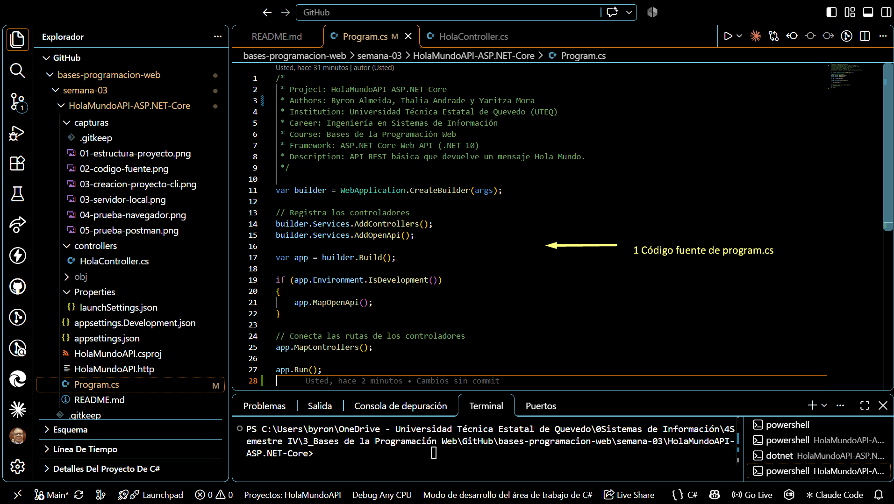
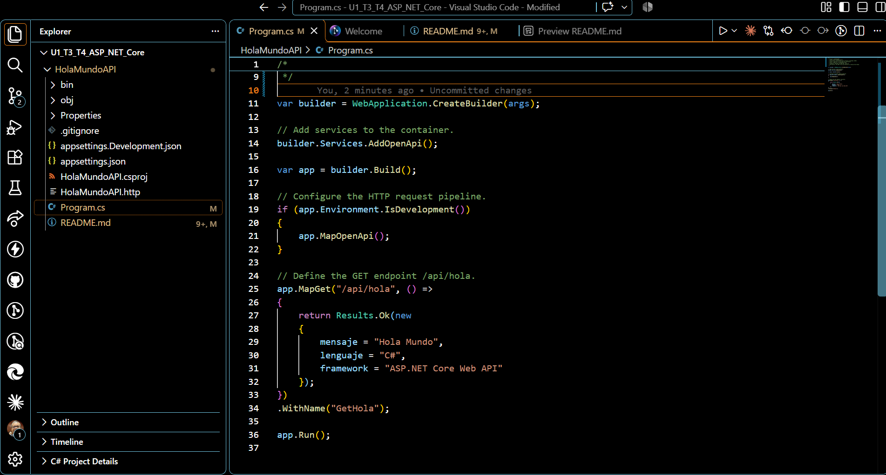
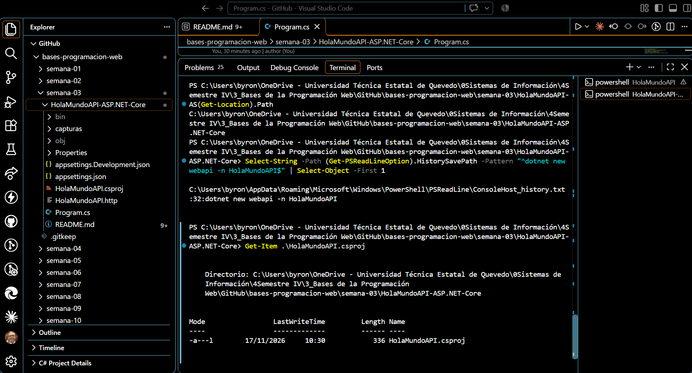
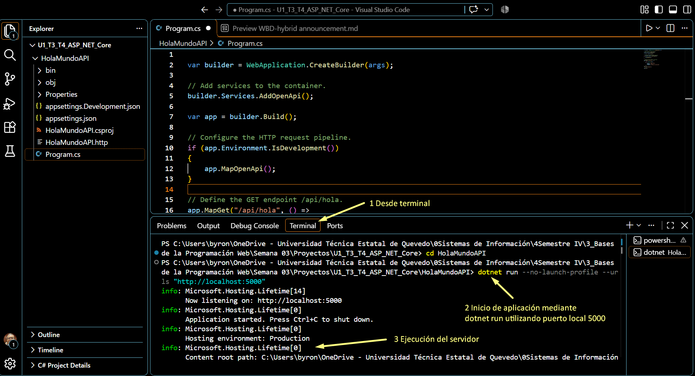
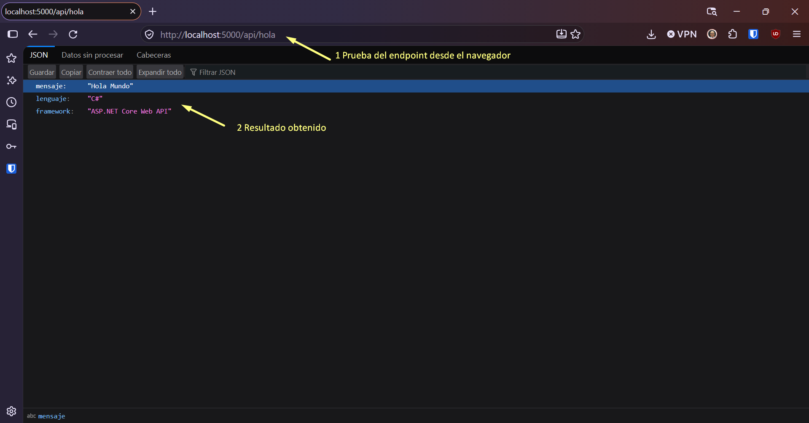
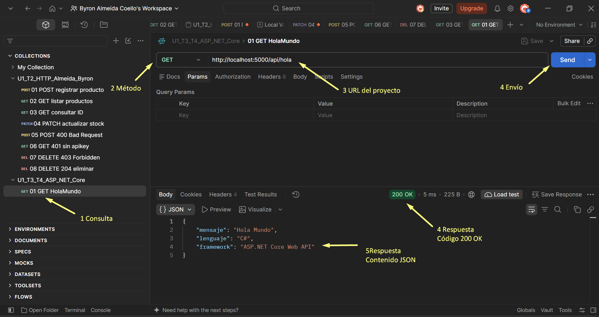

# 🚀 Hola Mundo API – C# | ASP.NET Core Web API

<p align="center">
  
  
  
  
</p>

<p align="center">
  API REST básica desarrollada con C# y ASP.NET Core Web API, como parte de las actividades prácticas de la asignatura <strong>Bases de la Programación Web</strong> de la Universidad Técnica Estatal de Quevedo (UTEQ).
</p>

---

## 📋 Descripción del proyecto

**HolaMundoAPI** es una aplicación web que implementa un servicio REST mediante ASP.NET Core Web API. Su propósito es demostrar la configuración del entorno de desarrollo, la creación de un proyecto desde cero, la implementación de un endpoint HTTP y la verificación de su funcionamiento.

La API expone una ruta de tipo `GET`, implementada mediante un controlador, que devuelve un mensaje de bienvenida en formato JSON, acompañado de información sobre el lenguaje y el framework utilizados.

## 🎯 Objetivos

- Configurar el entorno de desarrollo con C# y .NET.
- Crear una API REST utilizando ASP.NET Core Web API.
- Implementar un endpoint HTTP GET mediante controladores.
- Generar respuestas en formato JSON.
- Ejecutar y probar el servicio en un servidor local.
- Verificar las respuestas HTTP utilizando navegador y Postman.
- Publicar el código fuente y su documentación en GitHub.

## 🛠️ Tecnologías y herramientas

| Tecnología / Herramienta | Utilización |
|---|---|
| **C#** | Lenguaje de programación |
| **.NET 10 SDK** | Plataforma de desarrollo |
| **ASP.NET Core Web API** | Framework para construir la API REST |
| **Microsoft.AspNetCore.OpenApi** | Generación del documento OpenAPI en desarrollo |
| **Visual Studio Code** | Editor de código fuente |
| **C# Dev Kit** | Extensión para desarrollo con C# |
| **Postman** | Pruebas de solicitudes HTTP |
| **Git** | Control de versiones |
| **GitHub** | Alojamiento del repositorio |

## ⚙️ Características de la API

- Implementación mediante controladores (`ControllerBase`).
- Endpoint de tipo GET.
- Respuesta estructurada en formato JSON.
- Código HTTP `200 OK` cuando la solicitud se procesa correctamente.
- Ejecución en un servidor local.
- Configuración de entorno mediante ASP.NET Core.
- Documento OpenAPI disponible en el entorno de desarrollo.

## 🔌 Endpoint disponible

| Método HTTP | Ruta | Descripción |
|---|---|---|
| `GET` | `/api/hola` | Retorna un mensaje de bienvenida y los datos tecnológicos de la aplicación. |

**URL local (perfil HTTP predeterminado):**

```text
http://localhost:5165/api/hola
```

### 📦 Respuesta JSON

```json
{
  "mensaje": "Hola Mundo",
  "lenguaje": "C#",
  "framework": "ASP.NET Core Web API"
}
```

**Código de respuesta esperado:** `200 OK`.

## 📁 Estructura del proyecto

```text
HolaMundoAPI-ASP.NET-Core/
│
├── Properties/
│   └── launchSettings.json
│
├── controllers/
│   └── HolaController.cs
│
├── capturas/
│   ├── 01-estructura-proyecto.png
│   ├── 02-codigo-fuente.png
│   ├── 03-creacion-proyecto-cli.png
│   ├── 03-servidor-local.png
│   ├── 04-prueba-navegador.png
│   └── 05-prueba-postman.png
│
├── appsettings.Development.json
├── appsettings.json
├── HolaMundoAPI.csproj
├── HolaMundoAPI.http
├── Program.cs
└── README.md
```

## 💻 Instalación y ejecución

### 1. Requisitos previos

- Windows 10 o superior.
- .NET 10 SDK instalado.
- Visual Studio Code.
- Extensión C# Dev Kit.
- Postman para realizar pruebas.

### 2. Clonar el repositorio

```bash
git clone https://github.com/balmeidac/bases-programacion-web.git
```

### 3. Acceder al directorio del proyecto

```bash
cd bases-programacion-web/semana-03/HolaMundoAPI-ASP.NET-Core
```

### 4. Restaurar las dependencias

```bash
dotnet restore
```

### 5. Ejecutar la aplicación

```bash
dotnet run
```

Cuando el servidor se inicie correctamente, estará disponible en:

```text
http://localhost:5165
```

### 6. Probar el endpoint

Abre el navegador o Postman y realiza una solicitud GET a:

```text
http://localhost:5165/api/hola
```

La respuesta deberá mostrar el mensaje de bienvenida en formato JSON.

Para detener el servidor desde la terminal, presiona `Ctrl + C`.

## 📸 Capturas de pantalla

Las siguientes evidencias muestran la estructura, implementación y funcionamiento de la API REST.

### 1. 📁 Estructura del proyecto

Organización de carpetas y archivos del proyecto ASP.NET Core Web API en Visual Studio Code.



### 2. 💻 Código fuente – HolaController.cs

Implementación del endpoint `/api/hola` mediante un controlador de ASP.NET Core Web API.



### 3. 🛠️ Creación del proyecto mediante CLI

Creación del proyecto ASP.NET Core Web API desde la línea de comandos.



### 4. ▶️ Ejecución del servidor local

Inicio de la aplicación ASP.NET Core y escucha en el puerto 5165.



### 5. 🌐 Prueba del endpoint en el navegador

Consulta de la ruta `/api/hola` y visualización de la respuesta JSON.



### 6. 📬 Prueba con Postman

Solicitud GET, código de respuesta HTTP 200 OK y contenido JSON devuelto por la API.



## 👥 Integrantes del equipo

**Universidad Técnica Estatal de Quevedo – Ingeniería en Sistemas de Información**

| Integrante |
|---|
| 👨‍💻 **ALMEIDA COELLO BYRON OMAR** |
| 👩‍💻 **ANDRADE LOOR THALIA MERCEDES** |
| 👩‍🎨 **MORA QUIJIJE YARITZA CRISTHEL** |

## 🎓 Información académica

- **Institución:** Universidad Técnica Estatal de Quevedo (UTEQ).
- **Carrera:** Ingeniería en Sistemas de Información.
- **Asignatura:** Bases de la Programación Web.
- **Unidad:** Unidad 1.
- **Actividad:** Desarrollo de una API REST Hola Mundo.
- **Lenguaje:** C#.
- **Framework:** ASP.NET Core Web API.
- **Año:** 2026.

---

<p align="center">
  <strong>🚀 Aprendiendo, desarrollando y construyendo soluciones web.</strong>
</p>

<p align="center">
  <em>Proyecto académico desarrollado con fines educativos.</em>
</p>